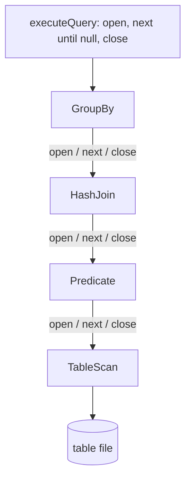
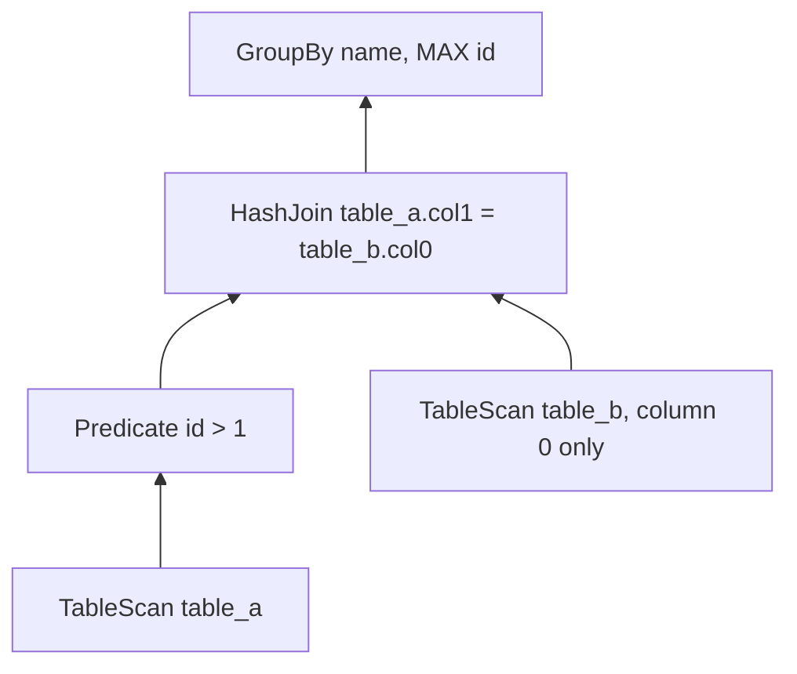

# Programmierpraktikum Datensysteme SS2024

Query processing of raw `|`-separated tables.

A query is a tree of `PlanNode`s. `Compiler` turns that tree into operators that implement `ONCIterator`. `executeQuery` then runs the root iterator: `open()`, `next()` until `null`, `close()`. Each `next()` returns one record. Parents pull from their children, so calls go down the tree and records come back up. Records can be reused, so the processor copies each one before storing it.




`Projection` does not appear above. When it sits directly on a `TableScan`, the compiler folds the column list into the scan. A chain of `Predicate` nodes becomes one predicate. `EquiJoin` becomes a `HashJoin`.

## Operators

- **TableScan** reads the file one line at a time. With a pushed-down projection it parses only the listed columns and skips the rest.
- **Projection** copies the requested columns into a smaller record. Used only when the child is not a scan.
- **Predicate** pulls the next child record and keeps it when every comparison against a literal matches.
- **HashJoin** loads the records from the right input into a hash map, then streams the left and emits each match. The output is every left column, then every right column except the join key.
- **NestedLoopJoin** does the same match by scanning the stored right input for each left row. 
- **GroupBy** reads its input once and keeps a running count, sum, min, and max per group. It then returns one record per group: the group key and the requested aggregate. With no group column it returns a single aggregate.


## Walkthrough

`BasicTest` builds this query. `table_a` is `id|col1|name` and `table_b` is `key|value`. The first three rows of each:

```text
table_a          table_b
0|1|abc|         0|21.4|
1|4|def|         1|11.3|
2|4|aab|         2|22.9|
```

```java
PlanNode scan = new PlanNode(NodeType.TableScan,
    Map.of("file_path", TestTables.TABLE_A), null);
PlanNode pred = new PlanNode(NodeType.Predicate,
    Map.of("column_id", "0", "condition", ">", "literal", "1"), new PlanNode[]{scan});
PlanNode scan2 = new PlanNode(NodeType.TableScan,
    Map.of("file_path", TestTables.TABLE_B), null);
PlanNode proj = new PlanNode(NodeType.Projection,
    Map.of("column_ids", "0"), new PlanNode[]{scan2});
PlanNode join = new PlanNode(NodeType.EquiJoin,
    Map.of("left_column_id", "1", "right_column_id", "0"), new PlanNode[]{pred, proj});
PlanNode groupBy = new PlanNode(NodeType.GroupBy,
    Map.of("group_by_column_id", "2", "aggregate_column_id", "0", "AggrType", "max"),
    new PlanNode[]{join});
```

Which in SQL terms looks like: 

```sql
SELECT name, MAX(id)
FROM table_a JOIN table_b ON table_a.col1 = table_b.col0
WHERE id > 1
GROUP BY name
```

The compiler folds `proj` into `scan2`, so `table_b` is read as a one-column scan:




`executeQuery` pulls the root. The first `next()` on `GroupBy` reads every join result once:


| id  | col1 | name |
| --- | ---- | ---- |
| 2   | 4    | aab  |
| 3   | 3    | abc  |
| 4   | 1    | def  |
| 5   | 2    | aab  |
| 6   | 2    | abc  |
| 7   | 1    | abc  |
| 8   | 0    | abc  |
| 9   | 1    | abc  |


Each name keeps a running max. `aab` ends at 5, `abc` at 9, `def` at 4. That same `next()` returns `(aab, 5)`. The next two calls return `(abc, 9)` and `(def, 4)`. The call after that returns `null`, and `close()` closes the join underneath.

```java
iter.open();
while ((r = iter.next()) != null) {
    ret.add(new Record(r));
}
iter.close();
```

